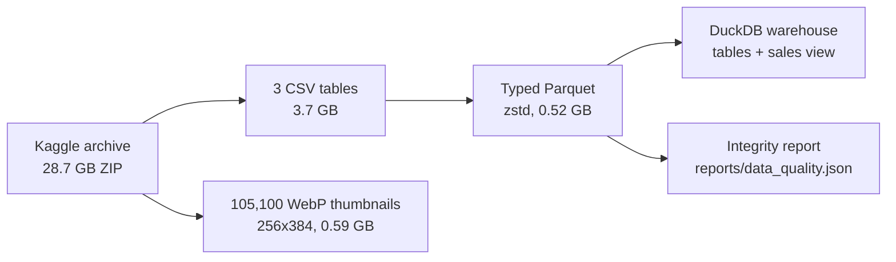
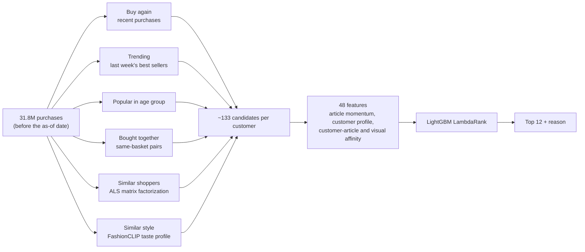
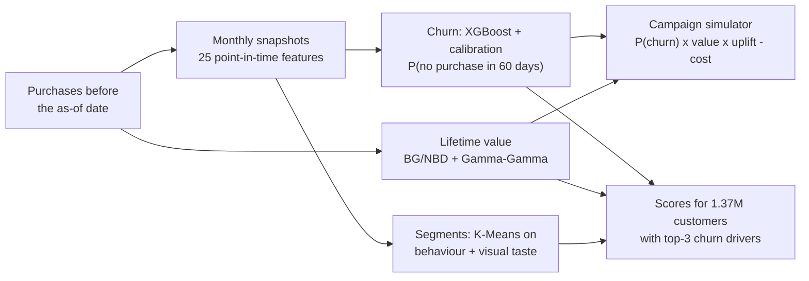

# E-Commerce Intelligence Engine

A local retail intelligence studio built on **31.8 million real fashion purchases** from the
[H&M Personalized Fashion Recommendations](https://www.kaggle.com/competitions/h-and-m-personalized-fashion-recommendations)
dataset: 1.37 million customers, 105,542 products, and 105,100 product photos.

The finished project will combine a two-stage product recommender, visual and natural-language product
search, churn and lifetime-value models, a campaign simulator, a Gemini-powered analyst copilot, and a
Next.js frontend. It runs entirely on a local PC; no cloud service is required.

> **Status: v2 is being built phase by phase.** The original UCI Online Retail version (FastAPI +
> Streamlit) is preserved at the
> [`v1-uci`](https://github.com/mehulp007/ECommerce-Intelligence-Engine/tree/v1-uci) tag.

| Phase | Scope | Status |
|---|---|---|
| 0 | Repository preparation | Done |
| 1 | Data foundation: H&M ingestion, DuckDB warehouse, integrity checks, thumbnails | Done |
| 2 | Two-stage recommender (candidate generation + LightGBM ranker, MAP@12) | Done |
| 3 | FashionCLIP image and text embeddings, similar-item and text search | Done |
| 4 | Churn, lifetime value, segments, campaign simulator | **Done** |
| 5 | FastAPI v2 | Planned |
| 6 | Gemini analyst copilot | Planned |
| 7 | Next.js frontend | Planned |
| 8 | CI, Docker Compose, final documentation | Planned |

## Data foundation (Phase 1)



- **Typed Parquet.** Article IDs stay ten-digit text so leading zeros survive; dates are real `DATE`
  values; customer flags become booleans; transactions are sorted by date for fast time filtering.
- **DuckDB warehouse.** `data/warehouse.duckdb` holds the `transactions`, `customers`, and `articles`
  tables plus a denormalized `sales` view (product, colour, department, channel, customer age) for
  analytics and the future copilot.
- **Integrity checks.** The pipeline fails if any transaction has nulls, a non-positive price, an unknown
  customer or article, or a date outside the published range, or if customer or article IDs repeat.
- **Thumbnails.** Photos are decoded straight from the ZIP in parallel worker processes, so the
  29 GB of images never needs to be unpacked.

### Measured results

| Item | Result |
|---|---|
| Transactions | 31,788,324 rows, 2018-09-20 to 2020-09-22 |
| Customers | 1,371,980 (1,362,281 with a purchase) |
| Articles | 105,542 (104,547 sold at least once; 105,100 with a photo) |
| Integrity checks | All passed |
| Online share of purchase rows | 70.4% |
| Parquet size | 0.52 GB (from 3.7 GB of CSV) |
| Runtime on an i7-14650HX, 16 GB RAM | ingest 28 s, warehouse 8 s, quality 10 s, thumbnails 225 s |

Weekly purchase volume peaks in late June 2019 (563k rows) and falls to its lowest full week in mid-March
2020 (184k rows) as COVID closed stores. Later phases treat this as a real distribution shift.

## Two-stage recommender (Phases 2 and 3)

The recommender predicts which articles each customer will buy next week. Like production
recommenders at large retailers, it works in two stages: cheap **candidate generators** propose about
130 articles per customer, then a **learned ranker** orders them.



**Evaluation protocol.** Training labels come from the weeks starting 26 Aug, 2 Sep, and 9 Sep 2020;
early stopping uses the 9 Sep week; the final week of data (16–22 Sep 2020, 68,984 buyers) is held out
and only used for the scores below. Every feature is computed from purchases strictly before the
as-of date, and a test inserts future purchases to prove they change nothing. The metric is MAP@12,
the metric of the original Kaggle competition.

### Held-out results (16–22 Sep 2020)

| Model | MAP@12 | Recall@12 |
|---|---|---|
| **Two-stage ranker (Phase 3)** | **0.0346** | **5.65%** |
| Two-stage ranker (Phase 2, no image signal) | 0.0344 | 5.67% |
| Buy again, then trending | 0.0257 | 3.89% |
| Bought together, then trending | 0.0116 | 2.70% |
| ALS (similar shoppers) only | 0.0112 | 2.01% |
| Trending (global popularity) | 0.0088 | 2.29% |

The ranker is **4.0x the popularity baseline** and **35% better than the strongest single
heuristic**. For context, the competition's winning private-leaderboard score was about 0.037 on a
different, hidden week, so the comparison is indicative only.

### What matters (ablations on the same held-out week)

| Removed | MAP@12 | Change |
|---|---|---|
| Customer-article affinity features (incl. visual similarity) | 0.0301 | -13.0% |
| Buy-again candidates | 0.0306 | -11.5% |
| Article features (momentum, price, category) | 0.0319 | -7.8% |
| Customer features | 0.0335 | -3.4% |
| Age-group candidates | 0.0340 | -2.0% |
| Bought-together candidates | 0.0340 | -1.7% |
| ALS candidates | 0.0342 | -1.2% |
| Trending candidates | 0.0345 | -0.5% |
| Similar-style candidates | 0.0348 | +0.5% |

Repeat purchases dominate fashion shopping, and personal affinity (how recently the customer bought
the article, how often they buy that product family and garment type, and how close it is to their
visual taste) is the most informative feature group. The image signal helps as a **ranking feature**:
`style_similarity` is the 11th of 48 features by gain, and removing the affinity group now costs 13.0%
instead of 9.5%. As a **candidate source** it does not help: its 25 extra candidates per customer add
slightly more noise than buyers, so removing them scores 0.5% higher. The production model keeps the
measured configuration rather than re-tuning on the held-out week.

### Production scoring

The production ranker is retrained including the held-out week, then scores every customer as of
23 Sep 2020: **16,463,760 recommendations for all 1,371,980 customers** in 12 minutes, each with a
reason (`buy_again`, `bought_together`, `similar_style`, `similar_shoppers`, `popular_in_age_group`,
`trending`). Recommendations cover 19.6% of the catalog. The full run, including evaluation and nine
ablation models, takes 33 minutes on an i7-14650HX with 16 GB RAM.

## Visual and natural-language product search (Phase 3)

Every product photo and description is embedded with
[FashionCLIP](https://huggingface.co/patrickjohncyh/fashion-clip) (MIT license), a CLIP ViT-B/32
model fine-tuned on 800k fashion products. The 512-dimensional vectors drive three features:

- **Find similar**: nearest photos by cosine similarity (FAISS exact search). For a black strap top,
  the six nearest products are all black vest tops with similarity 0.96-0.97.
- **Text search**: a query such as "red floral summer dress" is embedded by the text tower and scored
  against both photo and description (70% / 30%).
- **Visual taste**: each customer's recent purchases are averaged into a style profile used by the
  recommender above.

| Item | Result |
|---|---|
| Descriptions embedded | 105,542 in 48 s (RTX 4060 Laptop GPU, fp16) |
| Photos embedded | 105,100 in 8.6 minutes |
| Storage | 207 MB (float16) |
| Photo matches its own description, among 2,022 sampled products | 60.2% (chance: 0.05%) |
| Text search precision@10, 12 labelled queries | **0.95** (0.22 before the fix below) |

**Fixing "hub" products.** Raw CLIP text-to-photo scores were dominated by a few products, such as
sunglasses and earrings, that sit close to every query, so "black leather ankle boots" returned
sandals. Subtracting each modality's mean embedding before comparing (a standard fix for CLIP's
modality gap) raised photo-only precision@10 from 0.21 to 0.93; blending in the description gives
0.95. The weights were chosen on this same 12-query benchmark (`eie search evaluate`), so the number is
indicative rather than a held-out estimate.


## Customer intelligence (Phase 4)

Four models turn purchase history into retention decisions for every customer as of 23 Sep 2020.



### Churn (60-day inactivity proxy)

A customer counts as active at snapshot date T if they bought anything in the year before T. The label is
1 if they then buy nothing for 60 days. This is an inactivity proxy, not a closed account. Features use
only purchases before T, and a test inserts future purchases to prove they change nothing. Customer
attributes recorded at the end of the dataset (club status, newsletter flags) are excluded because
they would leak the future into older snapshots.

The split moves forward in time: train on snapshots from Oct 2019 to Feb 2020 (a 40% customer sample of
1.96M rows), calibrate on Mar–Apr 2020, and test on every active customer in May–Jul 2020 (2.96M
customer-months).

| Model (test, May–Jul 2020) | ROC AUC | Average precision | Brier score |
|---|---|---|---|
| **XGBoost, Optuna-tuned (25 trials), calibrated** | **0.795** | **0.857** | 0.178 |
| XGBoost, default settings | 0.795 | 0.856 | 0.178 |
| Logistic regression, all features | 0.789 | 0.851 | 0.180 |
| Logistic regression, recency only | 0.701 | 0.792 | 0.209 |
| XGBoost, tuned, uncalibrated | 0.795 | 0.857 | 0.175 |

ROC AUC is stable across test months (0.789, 0.798, 0.801). Purchase frequency, recency, and the usual
gap between visits drive the model most.

- **Tuning barely helps.** The engineered features carry the signal, not the hyperparameters.
- **COVID distorted calibration.** The calibration months, Mar–Apr 2020, were store-closure months with
  70% inactivity. Calibrating on them made test probabilities slightly worse (Brier 0.178 vs 0.175
  uncalibrated) and overstated risk for low-risk customers (predicted 0.27 vs observed 0.16 in the lowest
  decile). The production model is therefore retrained on Oct 2019–May 2020 and calibrated on Jun–Jul
  2020, the months closest to normal trading.
- **Explanations.** Each customer's three strongest drivers are exact TreeSHAP contributions to the raw
  log-odds, computed on the GPU (3.1x faster than CPU, identical to 1e-5). They explain the uncalibrated
  model, not the calibrated probability.

### Lifetime value (next 180 days)

BG/NBD (purchase-day frequency and dropout) and Gamma-Gamma (spend per visit) are implemented from the
published likelihoods (Fader, Hardie and Lee, 2005) and fitted by maximum likelihood on 1.19M customers
in about 20 seconds. A Monte Carlo test checks the closed-form expectation against a simulation of the
model. The model was checked by fitting on data before 26 Mar 2020 and predicting each customer's
spend through 22 Sep 2020:

| Model | Spend MAE | Correlation | Total predicted vs actual |
|---|---|---|---|
| **BG/NBD + Gamma-Gamma** | **0.139** | **0.668** | 204k vs 190k (+7.3%) |
| Same as the previous 181 days | 0.145 | 0.636 | 199k vs 190k (+4.5%) |
| Lifetime average rate | 0.209 | 0.455 | 327k vs 190k (+72%) |

The probabilistic model ranks and sizes customers best. It overstates the total by 7% over a period
that began with COVID lockdowns, and in the top decile it predicts 0.81 against 0.70 actual. Values are
in H&M's normalized price units.

### Segments

K-Means groups the 993,492 active customers using spend, visits, recency, channel, category mix, age, and
an 8-component summary of their visual style (from the Phase 3 embeddings). Five clusters scored the best
silhouette (0.193 among 5 to 8; customer behaviour is continuous, so clusters overlap). Names are
generated from the data. A category names a segment only when it is both over-represented and at least
30% of that segment's purchases.

| Segment | Customers | Median visits / year | Online share | Mean churn risk |
|---|---|---|---|---|
| Occasional womenswear shoppers | 436,354 | 2 | 67% | 0.76 |
| High-value multi-category shoppers | 281,905 | 8 | 68% | 0.32 |
| Occasional Divided (young fashion) shoppers | 188,462 | 2 | 74% | 0.75 |
| Regular menswear shoppers | 53,484 | 2 | 55% | 0.68 |
| Occasional sportswear shoppers | 33,287 | 1 | 69% | 0.76 |

The other 378,488 customers bought nothing in the 12 months before 23 Sep 2020 and are labelled lapsed.

### Campaign simulator

Contacting a customer with inactivity probability p and 180-day value V is worth p x uplift x V - cost in
expectation. The simulator contacts customers in order of that value until the budget runs out. It
stops early once a contact is no longer worth its cost.

With a cost of 0.005 per contact, a 10% uplift, and a budget of 500, it contacts 100,000 customers and
expects to save 2,300 value units, a net 1,800 (ROI 360%). Most contacts go to high-value shoppers:
their churn risk is lower, but far more value is at stake. Expected net value peaks at about 600,000
contacts and then declines. **The uplift is an assumption, not a measurement.** The data contains no
campaign experiments, so a real deployment would estimate uplift with an A/B test.

### Output

`data/serving/customer_scores.parquet` holds one row per customer (1,371,980). Each row has the churn
probability and risk band (low < 0.5 <= medium < 0.75 <= high, or lapsed), the top three drivers, the
segment, P(alive), expected visits, spend per visit, and 180-day value. The full run takes 13 minutes:
snapshots and churn evaluation 5 minutes, scoring 4 minutes.

## Run it on your PC

These steps use **Windows PowerShell** and **Python 3.12**. Run one command at a time.

### 1. Create the environment

From the project folder (the one containing `pyproject.toml`):

```powershell
py -3.12 -m venv .venv
.\.venv\Scripts\python.exe -m pip install --upgrade pip
.\.venv\Scripts\python.exe -m pip install torch --index-url https://download.pytorch.org/whl/cu128
.\.venv\Scripts\python.exe -m pip install -e ".[data,train,recsys,search,dev]"
```

### 2. Get access to the data

The dataset is not redistributed in this repository. Each user downloads it from Kaggle:

1. Sign in to Kaggle, open the
   [competition page](https://www.kaggle.com/competitions/h-and-m-personalized-fashion-recommendations),
   choose **Join Competition**, and accept the rules.
2. In **Kaggle → Settings → API**, create a new token and copy it.
3. Save it to your user profile (outside the project) and check that the file is not empty:

```powershell
New-Item -ItemType Directory -Force "$env:USERPROFILE\.kaggle"
notepad "$env:USERPROFILE\.kaggle\access_token"
(Get-Item "$env:USERPROFILE\.kaggle\access_token").Length
```

Paste the token into Notepad, save, and close it. The last command should print a number above zero.
Never commit or share the token.

### 3. Build the data foundation

```powershell
.\.venv\Scripts\eie.exe data all
```

This runs five steps, which can also be run individually:

| Command | What it does |
|---|---|
| `eie data download` | Downloads the 28.7 GB archive into `data/raw/hm/` (about 30 minutes at 17 MB/s) |
| `eie data ingest` | Extracts the CSV tables and writes typed Parquet to `data/parquet/` |
| `eie data warehouse` | Builds `data/warehouse.duckdb` |
| `eie data quality` | Writes `reports/data_quality.json` and fails if a check does not pass |
| `eie data thumbnails` | Writes WebP thumbnails to `data/thumbnails/` |

Optional settings: `EIE_DUCKDB_MEMORY` (default `6GB`) and `EIE_DUCKDB_THREADS` limit DuckDB's resource
use.

### 4. Embed and search the catalog

```powershell
.\.venv\Scripts\eie.exe search embed
.\.venv\Scripts\eie.exe search query "red floral summer dress"
.\.venv\Scripts\eie.exe search similar 0108775015
.\.venv\Scripts\eie.exe search evaluate
```

`embed` downloads FashionCLIP (about 600 MB) on first use and writes `data/embeddings/`; it uses the
GPU when PyTorch can see one and otherwise runs, more slowly, on the CPU. The recommender needs these
embeddings. The PyTorch command above installs the CUDA 12.8 build for NVIDIA GPUs.

### 5. Train the recommender

```powershell
.\.venv\Scripts\eie.exe recsys train
```

This evaluates on the held-out week, writes `reports/recommender_metrics.json`, saves the ranker to
`artifacts/recsys/`, and writes every customer's top 12 to `data/serving/recommendations.parquet`.
Add `--no-ablations` to skip the nine comparison models (about 12 minutes faster) or `--no-score` to
skip scoring all customers.

### 6. Score customers and plan a campaign

```powershell
.\.venv\Scripts\eie.exe customers train
.\.venv\Scripts\eie.exe customers campaign --budget 500 --cost 0.005 --uplift 0.1
```

`train` evaluates churn and lifetime value, fits segments, writes `reports/customer_metrics.json`, and
scores every customer into `data/serving/customer_scores.parquet` (about 13 minutes). `campaign` reads
those scores and prints who to contact and the expected return. Add `--trials 5` to `train` for a
faster, less thorough tuning run.

### 7. Explore the warehouse

```powershell
.\.venv\Scripts\python.exe -c "import duckdb; print(duckdb.connect('data/warehouse.duckdb', read_only=True).sql('SELECT index_group_name, count(*) AS purchases FROM sales GROUP BY ALL ORDER BY purchases DESC'))"
```

## Project layout

| Path | Contents |
|---|---|
| `src/ecommerce_intelligence/cli.py` | The `eie` command-line tool |
| `src/ecommerce_intelligence/data/` | Download, ingestion, warehouse, quality checks, thumbnails |
| `src/ecommerce_intelligence/recsys/` | Candidate generators, ALS, style profiles, features, LightGBM ranker, metrics, pipeline |
| `src/ecommerce_intelligence/search/` | FashionCLIP encoder, embeddings, FAISS index, search benchmark |
| `src/ecommerce_intelligence/customers/` | Snapshot features, churn, lifetime value, segments, campaign simulator, pipeline |
| `src/ecommerce_intelligence/evaluation/` | Shared metric helpers |
| `tests/` | Tests that run on a miniature synthetic H&M archive |
| `reports/` | Data-quality, thumbnail, recommender, search-quality, and customer reports |
| `data/`, `artifacts/` | Local data and generated outputs (Git-ignored) |

## Checks

```powershell
.\.venv\Scripts\python.exe -m pytest -q
.\.venv\Scripts\python.exe -m ruff check src tests
.\.venv\Scripts\python.exe -m black --check src tests
```

The tests build a small fake archive with the real file layout, so they run in seconds without the
real dataset.

## Data notes and limitations

- **Terms of use.** The H&M data is provided through Kaggle for non-commercial and academic use. This is
  a non-commercial portfolio project; raw data, images, and customer-level outputs are never committed.
- **Prices are normalized** by H&M and are not a real currency.
- **Repeated rows are kept.** 2,974,905 rows repeat an earlier row exactly; they represent several units
  bought together.
- **Sales channels.** `sales_channel_id = 2` is interpreted as online and `1` as store; the dataset does
  not document these codes.
- The data is historical (2018–2020), not live.
- **Churn is an inactivity proxy** (no purchase for 60 days), not a confirmed account closure, and
  SHAP drivers explain the raw model, not the calibrated probability.
- **Lifetime value sees only the dataset window.** Customers active before September 2018 look newer
  than they are.
- **Campaign uplift is an assumed input**; no campaign or experiment data exists in this dataset.
- Recommendations can include articles a customer already bought; these are labelled `buy_again`
  because repeat purchases are common in fashion.
