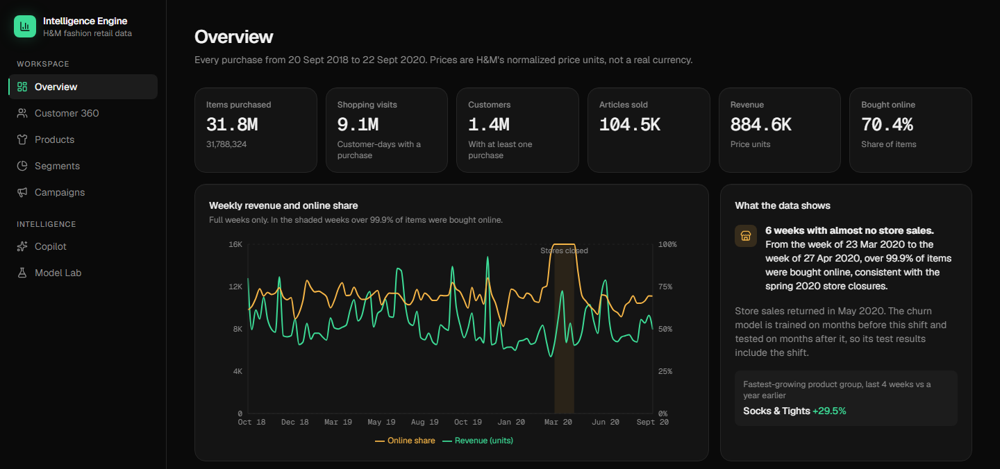
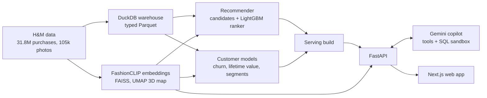

# E-Commerce Intelligence Engine

[](https://github.com/mehulp007/ECommerce-Intelligence-Engine/actions/workflows/ci.yml)


[](LICENSE)

A retail intelligence app built on **31.8 million real fashion purchases** from the
[H&M Personalized Fashion Recommendations](https://www.kaggle.com/competitions/h-and-m-personalized-fashion-recommendations)
dataset: 1.37 million customers and 105,542 products with photos. It recommends products, finds them
from a photo or a sentence, predicts which customers are about to lapse and what they are worth, plans
retention campaigns, and answers business questions through an AI analyst. Everything runs locally.



## Features

- **Recommendations.** A two-stage recommender: six candidate sources, including FashionCLIP visual
  taste, feed a LightGBM LambdaRank model. Every recommendation carries its reason.
- **Visual and text search.** FashionCLIP embeds every photo and description. Search with a sentence
  ("red floral summer dress") or find products that look alike.
- **Product Galaxy.** An interactive 3D map of all 105,542 products, laid out by UMAP so similar items
  sit together. Colour it by category, garment colour, price, or recent sales; search to fly to the
  matches; hover for the photo; click to open the product.
- **Customer 360.** Risk of going inactive with its SHAP drivers, predicted 180-day value, segment,
  purchase timeline, and personal recommendations for any of 1.37M customers.
- **Campaign simulator.** Ranks customers by expected value saved for a given budget, cost, and offer,
  with the full return curve.
- **Analyst copilot.** Gemini with function calling over a sandboxed, read-only SQL engine and the
  models above. Results stream into the chat as tables, charts, and product cards.
- **Model Lab.** Every held-out metric, baseline, ablation, and calibration check, in the app.
- **The story.** A 3D scroll tour at `/story`: the product Galaxy, two years of sales drawn week by
  week, the recommender's funnel, a search dive, a live customer-risk cloud with a budget slider, and a
  recorded copilot run. Every number on it comes from the API.

## Results

All results are on data the models never saw during training.

| Model | Result | Baseline |
|---|---|---|
| Recommender, final week (16–22 Sep 2020) | **MAP@12 0.0346**, recall@12 5.7% | 0.0087 best sellers; 0.0257 buy again, then best sellers |
| Inactivity model, May–Jul 2020 (2.96M customer-months) | **ROC AUC 0.795**, average precision 0.857 | 0.789 logistic regression; 0.701 recency only |
| 180-day value, 181-day holdout | **Spend correlation 0.668**, MAE 0.139 | 0.636 and 0.145, repeating the previous period |
| Text-to-product search, 12 labelled queries | **Precision@10 0.95** | 0.22 before correcting CLIP's modality gap |
| Product Galaxy, 10 nearest neighbours on the map | **92.2% same product group**, 60.3% same colour | 23.3% and 8.2% by chance |
| Copilot SQL guard | **15 of 15** attack queries blocked | |

The recommender scores 4.0× the best-seller baseline. For context, the competition's winning score was
about 0.037 on a different, hidden week.

## Architecture



- **Data.** CSV to typed Parquet and a DuckDB warehouse, with integrity checks that fail the build on
  nulls, orphans, or bad prices. Photos become WebP thumbnails straight from the ZIP.
- **Point-in-time correctness.** Every feature uses only purchases before its snapshot date, and tests
  insert future purchases to prove they change nothing.
- **Recommender.** Candidates from buy-again, best sellers, best sellers by age, bought-together, ALS,
  and visual style; 48 features; LambdaRank. Ablations measure what each source contributes.
- **Customers.** Monthly snapshots with 25 features and a forward 60-day inactivity label; XGBoost tuned
  with Optuna and calibrated; GPU TreeSHAP for drivers. BG/NBD and Gamma-Gamma for lifetime value;
  K-Means on behaviour and style for segments.
- **Copilot.** Queries must parse as one `SELECT` over five allow-listed tables; the connection is
  read-only with file and network access disabled; each query has a time and row limit. The assistant
  falls back to a second Gemini model when the first is busy or out of quota.
- **Web.** Next.js server routes add the API key, so it never reaches the browser. TypeScript types are
  generated from the API's OpenAPI schema, and a test catches drift.

## Tech stack

| Area | Tools |
|---|---|
| Data | DuckDB, Parquet (PyArrow), pandas |
| Machine learning | LightGBM, XGBoost, Optuna, implicit (ALS), scikit-learn, SHAP via XGBoost |
| Vision and search | FashionCLIP (PyTorch, Transformers), FAISS, UMAP |
| AI | Google Gemini (google-genai), function calling |
| Backend | FastAPI, Pydantic, Typer CLI |
| Frontend | Next.js 16, React 19, TypeScript, Tailwind CSS, TanStack Query, Recharts, three.js (React Three Fiber) |
| Ops | GitHub Actions, Docker Compose, pytest, Playwright, Ruff, Black, ESLint |

## Getting started

**Requirements:** Windows with PowerShell, Python 3.12, Node.js 20+, a free Kaggle account, and about
45 GB of free disk. An NVIDIA GPU makes the image-embedding step much faster but is optional.

**1. Install** (once). Creates the Python environment, installs PyTorch (with CUDA when an NVIDIA GPU
is present), the project, and the web app, and writes a `.env` with a private API key.

```powershell
powershell -ExecutionPolicy Bypass -File scripts\setup.ps1
```

**2. Get the data and build the models** (once).

1. On the [competition page](https://www.kaggle.com/competitions/h-and-m-personalized-fashion-recommendations),
   choose **Join Competition** and accept the rules.
2. In **Kaggle > Settings > API**, create a token and save it as `%USERPROFILE%\.kaggle\access_token`.
3. Run the full pipeline. It downloads the 29 GB archive, then builds the warehouse, embeddings,
   product map, recommender, customer models, and serving tables:

```powershell
.\.venv\Scripts\eie.exe build
```

**3. Run.** Starts the API and the web app and opens **http://127.0.0.1:3000**. Press Ctrl+C to stop.
The guided tour is at **http://127.0.0.1:3000/story**.

```powershell
powershell -ExecutionPolicy Bypass -File scripts\start.ps1
```

**Copilot (optional).** Add a Gemini API key from Google AI Studio to `.env` after `GEMINI_API_KEY=`.
The free tier allows about 20 requests per model per day; each question uses 3 to 5.

**Docker (alternative to step 3).** After step 2, run `docker compose up --build`. The first start
downloads FashionCLIP into a volume.

<details>
<summary>Commands</summary>

| Command | What it does |
|---|---|
| `eie build` | Runs every step below in order |
| `eie data all` | Download, typed Parquet, DuckDB warehouse, integrity report, thumbnails |
| `eie search embed` / `evaluate` / `galaxy` | FashionCLIP embeddings / search benchmark / 3D product map |
| `eie recsys train` | Evaluate on the final week, run ablations, score every customer |
| `eie customers train` | Churn, lifetime value, segments, and customer scores |
| `eie serve prepare` / `run` | Build the serving tables / start the API (docs at `/docs`) |
| `eie copilot ask "..."` | Ask the copilot from the terminal |

Each command has `--help`. DuckDB's memory use can be capped with `EIE_DUCKDB_MEMORY` (default `6GB`).

</details>

## Project structure

```
src/ecommerce_intelligence/
  data/        download, Parquet ingestion, warehouse, quality checks, thumbnails
  recsys/      candidate generators, ALS, features, LightGBM ranker, MAP@12
  search/      FashionCLIP encoder, embeddings, FAISS index, benchmark, 3D map
  customers/   snapshots, churn, lifetime value, segments, campaign planner
  serving/     serving build and read-only store
  api/         FastAPI app, settings, response schemas
  copilot/     SQL sandbox, tools, prompt, Gemini agent loop
web/           Next.js app (pages, views, charts, typed API client)
tests/         pytest suite on a miniature synthetic H&M archive
reports/       evaluation reports shown in the Model Lab
scripts/       setup and start scripts
```

## Development

```powershell
.\.venv\Scripts\python.exe -m pytest -q
.\.venv\Scripts\python.exe -m ruff check src tests
.\.venv\Scripts\python.exe -m black --check src tests
cd web; npm run lint; npm run typecheck; npm run build
```

The tests build a small fake archive with the real file layout, so they run in seconds without the
dataset. GitHub Actions runs these checks and builds both container images on every push.

## Data notes

- **Terms.** The H&M data is provided through Kaggle for non-commercial and academic use. It is not
  redistributed here: raw data, photos, models, and customer-level outputs are never committed.
- **Prices are normalized** by H&M, so values are shown as price units, not a currency.
- **Inactivity is a proxy for churn**: no purchase in the next 60 days. SHAP drivers explain the raw
  model's log-odds, not the calibrated probability.
- **Spring 2020 shift.** Store sales stop for five weeks from 23 Mar 2020. The churn model is tested on
  the months after, so its results include the shift.
- **Campaign uplift is an assumption**; the dataset has no experiment to measure it.
- **The copilot can misread a question.** Its numbers come from tools, and its SQL and tables are shown
  so answers can be checked.

## License

The code is released under the [MIT License](LICENSE). The H&M dataset is not covered by this license;
it remains under the Kaggle competition's terms.
