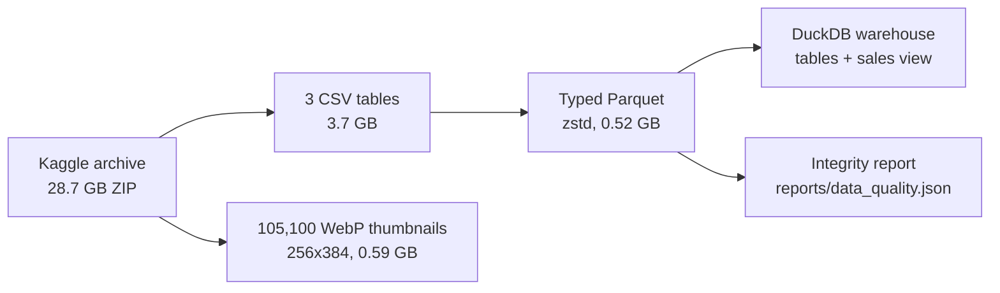

# E-Commerce Intelligence Engine

A local retail intelligence studio built on **31.8 million real fashion purchases** from the
[H&M Personalized Fashion Recommendations](https://www.kaggle.com/competitions/h-and-m-personalized-fashion-recommendations)
dataset: 1.37 million customers, 105,542 products, and 105,100 product photos.

The finished project will combine a two-stage product recommender, visual and natural-language product
search, churn and lifetime-value models, a campaign simulator, a Gemini-powered analyst copilot, and a
Next.js frontend. It runs entirely on a local PC; no cloud service is required.

> **Status: v2 is being built phase by phase.** The original UCI Online Retail version (FastAPI +
> Streamlit) is preserved at the
> [`v1-uci`](https://github.com/mehulp007/ECommerce-Intelligence-Engine/tree/v1-uci) tag.

| Phase | Scope | Status |
|---|---|---|
| 0 | Repository preparation | Done |
| 1 | Data foundation: H&M ingestion, DuckDB warehouse, integrity checks, thumbnails | **Done** |
| 2 | Two-stage recommender (candidate generation + LightGBM ranker, MAP@12) | Planned |
| 3 | FashionCLIP image and text embeddings, similar-item and text search | Planned |
| 4 | Churn, lifetime value, segments, campaign simulator | Planned |
| 5 | FastAPI v2 | Planned |
| 6 | Gemini analyst copilot | Planned |
| 7 | Next.js frontend | Planned |
| 8 | CI, Docker Compose, final documentation | Planned |

## Data foundation (Phase 1)



- **Typed Parquet.** Article IDs stay ten-digit text so leading zeros survive; dates are real `DATE`
  values; customer flags become booleans; transactions are sorted by date for fast time filtering.
- **DuckDB warehouse.** `data/warehouse.duckdb` holds the `transactions`, `customers`, and `articles`
  tables plus a denormalized `sales` view (product, colour, department, channel, customer age) for
  analytics and the future copilot.
- **Integrity checks.** The pipeline fails if any transaction has nulls, a non-positive price, an unknown
  customer or article, or a date outside the published range, or if customer or article IDs repeat.
- **Thumbnails.** Photos are decoded straight from the ZIP in parallel worker processes, so the
  29 GB of images never needs to be unpacked.

### Measured results

| Item | Result |
|---|---|
| Transactions | 31,788,324 rows, 2018-09-20 to 2020-09-22 |
| Customers | 1,371,980 (1,362,281 with a purchase) |
| Articles | 105,542 (104,547 sold at least once; 105,100 with a photo) |
| Integrity checks | All passed |
| Online share of purchase rows | 70.4% |
| Parquet size | 0.52 GB (from 3.7 GB of CSV) |
| Runtime on an i7-14650HX, 16 GB RAM | ingest 28 s, warehouse 8 s, quality 10 s, thumbnails 225 s |

Weekly purchase volume peaks in late June 2019 (563k rows) and falls to its lowest full week in mid-March
2020 (184k rows) as COVID closed stores. Later phases treat this as a real distribution shift.

## Run it on your PC

These steps use **Windows PowerShell** and **Python 3.12**. Run one command at a time.

### 1. Create the environment

From the project folder (the one containing `pyproject.toml`):

```powershell
py -3.12 -m venv .venv
.\.venv\Scripts\python.exe -m pip install --upgrade pip
.\.venv\Scripts\python.exe -m pip install -e ".[data,train,dev]"
```

### 2. Get access to the data

The dataset is not redistributed in this repository. Each user downloads it from Kaggle:

1. Sign in to Kaggle, open the
   [competition page](https://www.kaggle.com/competitions/h-and-m-personalized-fashion-recommendations),
   choose **Join Competition**, and accept the rules.
2. In **Kaggle → Settings → API**, create a new token and copy it.
3. Save it to your user profile (outside the project) and check that the file is not empty:

```powershell
New-Item -ItemType Directory -Force "$env:USERPROFILE\.kaggle"
notepad "$env:USERPROFILE\.kaggle\access_token"
(Get-Item "$env:USERPROFILE\.kaggle\access_token").Length
```

Paste the token into Notepad, save, and close it. The last command should print a number above zero.
Never commit or share the token.

### 3. Build the data foundation

```powershell
.\.venv\Scripts\eie.exe data all
```

This runs five steps, which can also be run individually:

| Command | What it does |
|---|---|
| `eie data download` | Downloads the 28.7 GB archive into `data/raw/hm/` (about 30 minutes at 17 MB/s) |
| `eie data ingest` | Extracts the CSV tables and writes typed Parquet to `data/parquet/` |
| `eie data warehouse` | Builds `data/warehouse.duckdb` |
| `eie data quality` | Writes `reports/data_quality.json` and fails if a check does not pass |
| `eie data thumbnails` | Writes WebP thumbnails to `data/thumbnails/` |

Optional settings: `EIE_DUCKDB_MEMORY` (default `6GB`) and `EIE_DUCKDB_THREADS` limit DuckDB's resource
use.

### 4. Explore the warehouse

```powershell
.\.venv\Scripts\python.exe -c "import duckdb; print(duckdb.connect('data/warehouse.duckdb', read_only=True).sql('SELECT index_group_name, count(*) AS purchases FROM sales GROUP BY ALL ORDER BY purchases DESC'))"
```

## Project layout

| Path | Contents |
|---|---|
| `src/ecommerce_intelligence/cli.py` | The `eie` command-line tool |
| `src/ecommerce_intelligence/data/` | Download, ingestion, warehouse, quality checks, thumbnails |
| `src/ecommerce_intelligence/evaluation/` | Shared metric helpers |
| `tests/` | Tests that run on a miniature synthetic H&M archive |
| `reports/` | Data-quality and thumbnail reports |
| `data/`, `artifacts/` | Local data and generated outputs (Git-ignored) |

## Checks

```powershell
.\.venv\Scripts\python.exe -m pytest -q
.\.venv\Scripts\python.exe -m ruff check src tests
.\.venv\Scripts\python.exe -m black --check src tests
```

The tests build a small fake archive with the real file layout, so they run in seconds without the
real dataset.

## Data notes and limitations

- **Terms of use.** The H&M data is provided through Kaggle for non-commercial and academic use. This is
  a non-commercial portfolio project; raw data, images, and customer-level outputs are never committed.
- **Prices are normalized** by H&M and are not a real currency.
- **Repeated rows are kept.** 2,974,905 rows repeat an earlier row exactly; they represent several units
  bought together.
- **Sales channels.** `sales_channel_id = 2` is interpreted as online and `1` as store; the dataset does
  not document these codes.
- The data is historical (2018–2020), not live.
